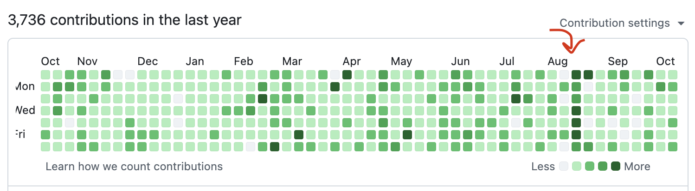

Much of my time at my previous job at The Alan Turing Institute was spent working on open-source Julia code.
That was very fun, and I think I made a lot of friends (for some definition of friend).
Consequently, even when I was moved off that project, I always thought that I'd just carry on writing Julia in my spare time anyway.

That has indeed been the case for a long time.
When I moved to a different project at that job, I kept working on Julia stuff (sometimes even during work hours).
During my couple of months off work I did a _lot_ of Julia, in fact possibly too much for my own good.
And even in the two months I've been at Jane Street, I've spent a lot of evening and weekend time on it.

Like, this is my GitHub activity chart, with the red arrow approximately being when I started:

There has been a little bit of drop-off, including more days where I didn't do anything on GitHub, but I'm clearly still going at it, which is a little bit insane.
(I should say that GitHub activity is not *perfectly* correlated with Julia work—indeed the act of writing this blog post will also count as GitHub activity.
However, Julia is certainly a massive proportion of my GitHub activity.)

## Why?

I am very, very happy at it, but my new job _is_ undoubtedly very tiring.
There are hard problems to solve, a lot to learn at once, and also a lovely commute.
It doesn't help that we are inching closer to winter: I like many things about winter, but trudging back home from the office long after sunset is not one of them.

Despite this, there are several reasons why I still spend a lot of my free time on Julia.

1. It's my comfort zone! After a long work day where I feel like I've been banging my head against a wall of types, it's nice to be able to feel like I'm capable of coding.
   (Yes, there's some level of impostor syndrome from work—it was pretty bad at the start—but that's a story for another time!)
   There's also a social aspect to it: I feel at least somewhat socially secure, because I've been around for a while and have interacted with various people, as opposed to work where I'm still relatively new.

2. I still feel some level of responsibility for the packages I manage.
   JuliaFormatter in fact seems to be doing OK: the huge burst of work I put into fixing bugs in May/June seems to have paid off in that nobody is constantly complaining about it being buggy.
   But there is also FlexiChains, which I'm trying to prepare a new minor version of now, and also various other Bayesian stuff.

3. Somehow, in a very odd way, there has actually been some momentum around the JuliaBayes organisation.
   That is kind of exciting in its own right.
   Now, I don't really know where it's going, and this shouldn't be taken as me saying that it's going to be the next big thing.
   But I think it's always nice when you feel like there is a common goal to work towards.

Unfortunately, I do also feel that I really want to stop doing open-source Julia work, or more likely just do it way less.

## ... Why?

To refute the three points above:

1. I am actually getting more comfortable with work.
   There's still a lot I don't know, and that will almost certainly stay true in the future.
   But I know enough to start writing code that isn't just outright trivial.
   So I don't need to fall back onto Julia as a 'familiar' kind of coding.

2. FlexiChains is now in an organisation, and this really means that in the long term I don't have to be the person who micromanages it any more.
   I think we would still need to be able to have more people chip in with maintenance work, but in fact this has happened over the past few months and I'm very heartened by that.
   I don't think that there are any other Julia packages under my personal GitHub account anymore.

   So, the only real blocker here is that I need to psychologically cede authority over what used to be 'my' packages.
   That won't be easy for me personally, but it's also not 'hard', in the sense that there is no reason why that can't happen.

3. This is probably the most 'controversial' part of this post, but I think that even though this is exciting in many ways, it also makes it way less fun for me. :(

   For one, there are users and expectations to deal with.
   This is in some ways a blessing, of course: it means that my software is good enough to be depended upon, and that it's actually making other people's lives (hopefully!) better.
   But it also brings with it a sense of obligation, and what I can only describe as a feeling of being permanently tied to it; that no matter what I am doing, I will always have to come back to look at issues and PRs.
   This feeling of obligation is at least somewhat tolerable when it's my job.
   However, Julia is no longer my job.
   I want to be able to do fun stuff in my free time.
   My actual job gives me enough obligations!

   Of course, it's slightly hyperbolic to claim that I can _never_ escape these obligations.
   I can always simply _stop_ doing so, by choosing to actively stop or reduce my maintenance.
   But that's exactly the point I am making here—I _must_ consciously do so, sooner or later, or else I will actually be the one tying myself to it in a self-flagellating way.

   Apart from that, 'proper' software is simply less fun because there are all sorts of tiny details that need to be paid attention to.
   This means that there is no longer the joy of figuring out how to do something even if it's imperfect; instead it's replaced by a slog of fixing bugs and eliminating edge cases.
   Again, this isn't a bad thing in and of itself, but I'd rather deal with that at work, instead of in my free time.

   And finally, with professional software there's more of a focus on getting things done and being productive.
   This, in turn, means using LLMs to code.
   The usual drawback of AI coding is that you learn less about the codebase and what you're doing, but it's very unlikely that I'm really going to learn anything new about something like FlexiChains, so that's a moot point here.
   Now, in general, I am a huge fan of LLMs, but it's undeniable that they take out a lot of the joy of coding: you don't get to solve a puzzle any more, instead you're handed the solution.

So... I can't say I'm entirely ready to pass on the mantle yet, but I _do_ know that I must do so at some point, whether gradually or abruptly.
I can't sit here for many more evenings and do something that doesn't really make me happy anymore.

There are so many more things that I want to do with my increasingly limited time.
These include the usual household chores; or cooking; or gardening (a dangerous act because the more you garden the more time you have to spend on it); or practising all the musical instruments I have; or reading books (I watched *Sense and Sensibility* in the cinemas and that reminded me how much I liked reading Austen, and even some literary theory); or playing the Switch 2 I bought but rarely play; or just coding...

... but specifically, fun types of coding!
For example, I still have a ton of compiler books to read, and I've added type theory stuff to that as well, because ... well ... I _am_ in a team that works on type systems.
And it's cool!
I'm not going to become a compiler genius, but I'd certainly like to learn a bit.
And, if I'm just writing some half-baked compiler or type checker that nobody is going to depend on, that lets me do things at my own pace, undisturbed, and with less vibe coding.
(I still talk to LLMs a lot to gain more understanding—a little bit like having a colleague to bounce ideas off—but I certainly wouldn't get it to write the actual code.)

That doesn't necessarily mean abandoning Julia, because there are plenty of compiler projects in Julia, but it might mean eventually closing the chapter on Bayesian stuff.
